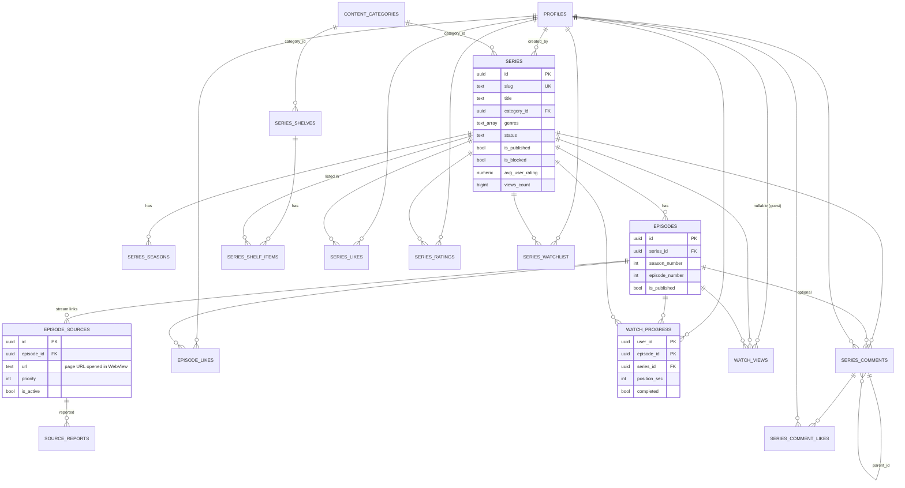

# Reelo — Series App Schema (Series-only)

> Source: live Qylomi Supabase DB (`ffbmozwsasbhevtehbit`), filtered to **series-related objects only**.
> Social, groups, wallet, monetization, playlists, posts → **not included**.
> Same Supabase project and same login as the other apps. Only the series tables below are touched by this app.

---

## 1. Scope

| Group | Tables |
|---|---|
| Catalog | `content_categories`, `series`, `series_seasons`, `episodes`, `episode_sources` |
| Home page | `series_shelves`, `series_shelf_items` |
| User actions | `series_likes`, `episode_likes`, `series_ratings`, `series_watchlist`, `watch_progress`, `series_comments`, `series_comment_likes` |
| Analytics / moderation | `watch_views`, `source_reports` |
| **Shared (not owned by this app)** | `auth.users`, `profiles` (only `id, username, display_name, avatar_url, role` are read) |

**RPC used by the app:** `get_series_home`, `search_series`, `get_related_series`, `get_continue_watching`, `record_view`

**Not used by the Reelo app (Studio app later):** insert/update/delete on `series`, `episodes`, `episode_sources`, `series_shelves`, `content_categories`. RLS already allows this only for `creator` (own series) and `admin`.

---

## 2. ER diagram



---

## 3. How the app reads data

| Screen | Call |
|---|---|
| Category chips | `from('content_categories')` where `is_active`, order `sort_order` |
| Home | `rpc('get_series_home', {p_category})` → shelves + series cards |
| Continue watching | `rpc('get_continue_watching', {p_limit})` (logged in) |
| Search | `rpc('search_series', {q, p_category, lim, off})` |
| Series info | `from('series')` by `slug` + `from('series_seasons')` + `from('episodes')` + `rpc('get_related_series')` |
| Watch | `from('episode_sources')` by `episode_id`, order `priority`; `rpc('record_view')` |
| Progress | upsert `watch_progress` |
| Like / Watchlist / Rate | insert/delete on `series_likes`, `series_watchlist`, `series_ratings` |
| Comments | `series_comments` (+ embed `profiles(username,display_name,avatar_url)`) |
| Report broken link | insert `source_reports` |

**Series card JSON** (returned by every RPC): `id, slug, title, original_title, description (280 chars), poster_url, banner_url, category{id,slug,name}, genres[], languages[], rating, avg_user_rating, ratings_count, status, release_year, age_rating, is_mature, episodes_count, last_episode_at, views_count, likes_count, created_at`

---

## 4. Full SQL

Run in this order. Everything is idempotent (safe to run again).
**Section 4.0 is only for a brand-new DB.** If the shared Qylomi DB already has `profiles`, skip it.

### 4.0 Shared prerequisites (skip if the Qylomi DB already has them)

```sql
create extension if not exists pg_trgm with schema public;
create schema if not exists private;
set check_function_bodies = off;

-- Minimal profiles (real DB has more columns; they are not needed here)
create table if not exists public.profiles (
  id           uuid primary key references auth.users(id) on delete cascade,
  username     text not null unique check (char_length(username) between 3 and 30),
  display_name text not null,
  avatar_url   text,
  role         text not null default 'user' check (role in ('user','creator','admin')),
  created_at   timestamptz not null default timezone('utc', now()),
  updated_at   timestamptz not null default timezone('utc', now())
);
alter table public.profiles enable row level security;

do $$ begin
  if not exists (select 1 from pg_policies where schemaname='public' and tablename='profiles' and policyname='Public profiles are viewable by everyone') then
    create policy "Public profiles are viewable by everyone" on public.profiles for select using (true);
  end if;
  if not exists (select 1 from pg_policies where schemaname='public' and tablename='profiles' and policyname='Users can insert their own profile') then
    create policy "Users can insert their own profile" on public.profiles for insert with check (auth.uid() = id);
  end if;
  if not exists (select 1 from pg_policies where schemaname='public' and tablename='profiles' and policyname='Users can update own profile') then
    create policy "Users can update own profile" on public.profiles for update using (auth.uid() = id);
  end if;
end $$;

-- Role helpers (used by RLS)
create or replace function private.is_admin()
returns boolean language sql stable security definer set search_path to '' as $$
  select coalesce((select role = 'admin' from public.profiles where id = (select auth.uid())), false);
$$;

create or replace function private.is_creator_or_admin()
returns boolean language sql stable security definer set search_path to '' as $$
  select coalesce((select role in ('creator','admin') from public.profiles where id = (select auth.uid())), false);
$$;

-- Nobody but an admin can change roles
create or replace function private.guard_profile_role()
returns trigger language plpgsql security definer set search_path to '' as $$
declare v_uid uuid := (select auth.uid());
begin
  if tg_op = 'INSERT' then
    if v_uid is not null and new.role <> 'user' and not private.is_admin() then
      new.role := 'user';
    end if;
    return new;
  end if;
  if new.role is distinct from old.role and v_uid is not null then
    if not private.is_admin() then
      raise exception 'Only an admin can change user roles' using errcode = '42501';
    end if;
    if old.role = 'admin' and new.role <> 'admin'
       and not exists (select 1 from public.profiles p where p.role = 'admin' and p.id <> old.id) then
      raise exception 'Cannot remove the last admin' using errcode = 'P0001';
    end if;
  end if;
  return new;
end $$;

drop trigger if exists trg_profiles_guard_role on public.profiles;
create trigger trg_profiles_guard_role before insert or update on public.profiles
  for each row execute function private.guard_profile_role();

-- Auto-create profile on signup
create or replace function public.handle_new_user()
returns trigger language plpgsql security definer set search_path to 'public', 'pg_temp' as $$
declare clean_username text;
begin
  clean_username := coalesce(new.raw_user_meta_data->>'username', 'user_' || substring(new.id::text, 1, 8));
  insert into public.profiles (id, username, display_name, avatar_url)
  values (new.id, clean_username,
          coalesce(new.raw_user_meta_data->>'display_name', clean_username),
          new.raw_user_meta_data->>'avatar_url')
  on conflict (id) do nothing;
  return new;
end $$;

drop trigger if exists on_auth_user_created on auth.users;
create trigger on_auth_user_created after insert on auth.users
  for each row execute function public.handle_new_user();
```

### 4.1 Tables

```sql
create table if not exists public.content_categories (
  id         uuid primary key default gen_random_uuid(),
  slug       text not null unique check (slug ~ '^[a-z0-9-]+$'),
  name       text not null,
  sort_order integer not null default 0,
  is_active  boolean not null default true,
  created_at timestamptz not null default now(),
  updated_at timestamptz not null default now()
);

create table if not exists public.series (
  id                 uuid primary key default gen_random_uuid(),
  slug               text not null unique check (slug ~ '^[a-z0-9-]+$'),
  title              text not null check (char_length(title) between 1 and 200),
  original_title     text,
  description        text,
  poster_url         text,
  banner_url         text,
  trailer_url        text,
  category_id        uuid references public.content_categories(id) on delete set null,
  genres             text[] not null default '{}'::text[],
  languages          text[] not null default '{}'::text[],
  subtitle_languages text[] not null default '{}'::text[],
  rating             numeric check (rating >= 0 and rating <= 10),
  age_rating         text,
  is_mature          boolean not null default false,
  status             text not null default 'ongoing' check (status in ('ongoing','completed','upcoming')),
  release_year       integer check (release_year between 1900 and 2100),
  studio             text,
  total_episodes     integer check (total_episodes >= 0),
  is_published       boolean not null default false,
  is_featured        boolean not null default false,
  is_blocked         boolean not null default false,
  blocked_reason     text,
  created_by         uuid references public.profiles(id) on delete set null,
  avg_user_rating    numeric not null default 0,
  ratings_count      integer not null default 0,
  likes_count        integer not null default 0,
  comments_count     integer not null default 0,
  views_count        bigint  not null default 0,
  episodes_count     integer not null default 0,
  last_episode_at    timestamptz,
  created_at         timestamptz not null default now(),
  updated_at         timestamptz not null default now()
);

create table if not exists public.series_seasons (
  id            uuid primary key default gen_random_uuid(),
  series_id     uuid not null references public.series(id) on delete cascade,
  season_number integer not null check (season_number >= 0),
  title         text,
  description   text,
  poster_url    text,
  created_at    timestamptz not null default now(),
  updated_at    timestamptz not null default now(),
  unique (series_id, season_number)
);

create table if not exists public.episodes (
  id               uuid primary key default gen_random_uuid(),
  series_id        uuid not null references public.series(id) on delete cascade,
  season_number    integer not null default 1 check (season_number >= 0),
  episode_number   integer not null check (episode_number >= 0),
  title            text,
  description      text,
  thumbnail_url    text,
  duration_seconds integer check (duration_seconds >= 0),
  air_date         date,
  intro_start_sec  integer check (intro_start_sec >= 0),
  intro_end_sec    integer check (intro_end_sec >= 0),
  is_published     boolean not null default true,
  likes_count      integer not null default 0,
  comments_count   integer not null default 0,
  views_count      bigint  not null default 0,
  created_by       uuid references public.profiles(id) on delete set null,
  created_at       timestamptz not null default now(),
  updated_at       timestamptz not null default now(),
  unique (series_id, season_number, episode_number)
);

-- url = the web page that hosts the video (opened inside the app's browser/WebView)
create table if not exists public.episode_sources (
  id         uuid primary key default gen_random_uuid(),
  episode_id uuid not null references public.episodes(id) on delete cascade,
  label      text not null default 'Server 1',
  url        text not null check (url ~* '^https?://'),
  platform   text,
  language   text,
  quality    text,
  priority   integer not null default 0,          -- lower number = tried first
  is_active  boolean not null default true,
  fail_count integer not null default 0,
  last_ok_at timestamptz,
  created_at timestamptz not null default now(),
  updated_at timestamptz not null default now()
);

create table if not exists public.source_reports (
  id         uuid primary key default gen_random_uuid(),
  source_id  uuid not null references public.episode_sources(id) on delete cascade,
  user_id    uuid not null references public.profiles(id) on delete cascade,
  reason     text not null check (reason in ('broken','wrong_episode','copyright','other')),
  details    text check (details is null or char_length(details) <= 1000),
  status     text not null default 'open' check (status in ('open','handled')),
  handled_by uuid references public.profiles(id) on delete set null,
  handled_at timestamptz,
  created_at timestamptz not null default now()
);

create table if not exists public.series_shelves (
  id          uuid primary key default gen_random_uuid(),
  slug        text not null unique check (slug ~ '^[a-z0-9-]+$'),
  title       text not null,
  type        text not null check (type in ('manual','genre','category','auto_trending','latest_episodes','top_rated','hero')),
  layout      text not null default 'row' check (layout in ('row','hero','top10','grid')),
  config      jsonb not null default '{}'::jsonb,   -- {"genre":"action"} | {"category":"anime"} | {"days":7}
  category_id uuid references public.content_categories(id) on delete cascade,
  position    integer not null default 0,
  is_active   boolean not null default true,
  max_items   integer not null default 15 check (max_items between 1 and 50),
  created_at  timestamptz not null default now(),
  updated_at  timestamptz not null default now()
);

create table if not exists public.series_shelf_items (
  shelf_id   uuid not null references public.series_shelves(id) on delete cascade,
  series_id  uuid not null references public.series(id) on delete cascade,
  position   integer not null default 0,
  created_at timestamptz not null default now(),
  primary key (shelf_id, series_id)
);

create table if not exists public.series_likes (
  series_id  uuid not null references public.series(id)   on delete cascade,
  user_id    uuid not null references public.profiles(id) on delete cascade,
  created_at timestamptz not null default now(),
  primary key (series_id, user_id)
);

create table if not exists public.episode_likes (
  episode_id uuid not null references public.episodes(id) on delete cascade,
  user_id    uuid not null references public.profiles(id) on delete cascade,
  created_at timestamptz not null default now(),
  primary key (episode_id, user_id)
);

create table if not exists public.series_ratings (
  series_id  uuid not null references public.series(id)   on delete cascade,
  user_id    uuid not null references public.profiles(id) on delete cascade,
  rating     integer not null check (rating between 1 and 10),
  created_at timestamptz not null default now(),
  updated_at timestamptz not null default now(),
  primary key (series_id, user_id)
);

create table if not exists public.series_watchlist (
  user_id    uuid not null references public.profiles(id) on delete cascade,
  series_id  uuid not null references public.series(id)   on delete cascade,
  created_at timestamptz not null default now(),
  primary key (user_id, series_id)
);

create table if not exists public.watch_progress (
  user_id      uuid not null references public.profiles(id) on delete cascade,
  episode_id   uuid not null references public.episodes(id) on delete cascade,
  series_id    uuid not null references public.series(id)   on delete cascade,
  position_sec integer not null default 0 check (position_sec >= 0),
  duration_sec integer check (duration_sec >= 0),
  completed    boolean not null default false,
  updated_at   timestamptz not null default now(),
  primary key (user_id, episode_id)
);

create table if not exists public.watch_views (
  id         uuid primary key default gen_random_uuid(),
  user_id    uuid references public.profiles(id) on delete set null,
  viewer_key text,                                   -- guest device key
  series_id  uuid not null references public.series(id)   on delete cascade,
  episode_id uuid references public.episodes(id) on delete cascade,
  created_at timestamptz not null default now()
);

create table if not exists public.series_comments (
  id          uuid primary key default gen_random_uuid(),
  series_id   uuid not null references public.series(id)   on delete cascade,
  episode_id  uuid references public.episodes(id)          on delete cascade,   -- null = series-level comment
  user_id     uuid not null references public.profiles(id) on delete cascade,
  parent_id   uuid references public.series_comments(id)   on delete cascade,
  content     text not null check (char_length(content) between 1 and 3000),
  likes_count integer not null default 0,
  created_at  timestamptz not null default now(),
  updated_at  timestamptz not null default now()
);

create table if not exists public.series_comment_likes (
  comment_id uuid not null references public.series_comments(id) on delete cascade,
  user_id    uuid not null references public.profiles(id)        on delete cascade,
  created_at timestamptz not null default now(),
  primary key (comment_id, user_id)
);
```

### 4.2 Indexes

```sql
-- series
create index if not exists idx_series_category          on public.series (category_id);
create index if not exists idx_series_created_by        on public.series (created_by);
create index if not exists idx_series_genres            on public.series using gin (genres);
create index if not exists idx_series_languages         on public.series using gin (languages);
create index if not exists idx_series_last_episode      on public.series (last_episode_at desc nulls last);
create index if not exists idx_series_orig_title_trgm   on public.series using gin (original_title gin_trgm_ops);
create index if not exists idx_series_title_trgm        on public.series using gin (title gin_trgm_ops);
create index if not exists idx_series_published_created on public.series (is_published, created_at desc);

-- episodes / sources / reports
create index if not exists idx_episodes_created_by      on public.episodes (created_by);
create index if not exists idx_sources_episode_priority on public.episode_sources (episode_id, priority);
create index if not exists idx_source_reports_source    on public.source_reports (source_id);
create index if not exists idx_source_reports_user      on public.source_reports (user_id);
create index if not exists source_reports_status_idx    on public.source_reports (status, created_at desc);

-- shelves
create index if not exists idx_shelves_category   on public.series_shelves (category_id);
create index if not exists idx_shelves_position   on public.series_shelves (position) where is_active;
create index if not exists idx_shelf_items_series on public.series_shelf_items (series_id);

-- user actions
create index if not exists idx_series_likes_user     on public.series_likes (user_id);
create index if not exists idx_episode_likes_user    on public.episode_likes (user_id);
create index if not exists idx_series_ratings_user   on public.series_ratings (user_id);
create index if not exists idx_watchlist_series      on public.series_watchlist (series_id);
create index if not exists idx_progress_episode      on public.watch_progress (episode_id);
create index if not exists idx_progress_series       on public.watch_progress (series_id);
create index if not exists idx_progress_user_updated on public.watch_progress (user_id, updated_at desc);
create index if not exists idx_views_episode_created on public.watch_views (episode_id, created_at desc);
create index if not exists idx_views_series_created  on public.watch_views (series_id, created_at desc);
create index if not exists idx_views_user            on public.watch_views (user_id) where user_id is not null;
create index if not exists idx_comments_episode        on public.series_comments (episode_id);
create index if not exists idx_comments_parent         on public.series_comments (parent_id);
create index if not exists idx_comments_series_episode on public.series_comments (series_id, episode_id, parent_id, created_at);
create index if not exists idx_comments_user           on public.series_comments (user_id);
create index if not exists idx_comment_likes_user      on public.series_comment_likes (user_id);
```

### 4.3 Private helper & trigger functions

```sql
create or replace function private.set_updated_at()
returns trigger language plpgsql set search_path to '' as $$
begin new.updated_at := now(); return new; end $$;

create or replace function private.owns_series(p_series_id uuid)
returns boolean language sql stable security definer set search_path to '' as $$
  select exists (select 1 from public.series s where s.id = p_series_id and s.created_by = (select auth.uid()));
$$;

create or replace function private.owns_episode(p_episode_id uuid)
returns boolean language sql stable security definer set search_path to '' as $$
  select exists (
    select 1 from public.episodes e join public.series s on s.id = e.series_id
    where e.id = p_episode_id and s.created_by = (select auth.uid()));
$$;

create or replace function private.owns_source(p_source_id uuid)
returns boolean language sql stable security definer set search_path to '' as $$
  select exists (
    select 1 from public.episode_sources src
    join public.episodes e on e.id = src.episode_id
    join public.series s on s.id = e.series_id
    where src.id = p_source_id and s.created_by = (select auth.uid()));
$$;

create or replace function private.comment_in_series(p_comment_id uuid, p_series_id uuid)
returns boolean language sql stable security definer set search_path to '' as $$
  select exists (select 1 from public.series_comments c where c.id = p_comment_id and c.series_id = p_series_id);
$$;

-- Normalise arrays; non-admins cannot feature/block
create or replace function private.fn_series_guard()
returns trigger language plpgsql security definer set search_path to '' as $$
declare v_uid uuid := (select auth.uid());
begin
  new.genres := array(select x from (select lower(btrim(g)) as x, min(o) as o
      from unnest(coalesce(new.genres, '{}'::text[])) with ordinality t(g, o)
      where btrim(g) <> '' group by 1) q order by o);
  new.languages := array(select x from (select lower(btrim(g)) as x, min(o) as o
      from unnest(coalesce(new.languages, '{}'::text[])) with ordinality t(g, o)
      where btrim(g) <> '' group by 1) q order by o);
  new.subtitle_languages := array(select x from (select lower(btrim(g)) as x, min(o) as o
      from unnest(coalesce(new.subtitle_languages, '{}'::text[])) with ordinality t(g, o)
      where btrim(g) <> '' group by 1) q order by o);

  if v_uid is not null and not private.is_admin() then
    if tg_op = 'INSERT' then
      new.is_featured := false; new.is_blocked := false; new.blocked_reason := null;
    else
      new.is_featured := old.is_featured; new.is_blocked := old.is_blocked; new.blocked_reason := old.blocked_reason;
    end if;
  end if;
  return new;
end $$;

create or replace function private.fn_series_likes_count()
returns trigger language plpgsql security definer set search_path to '' as $$
begin
  if tg_op = 'INSERT' then update public.series set likes_count = likes_count + 1 where id = new.series_id;
  else update public.series set likes_count = greatest(likes_count - 1, 0) where id = old.series_id; end if;
  return null;
end $$;

create or replace function private.fn_episode_likes_count()
returns trigger language plpgsql security definer set search_path to '' as $$
begin
  if tg_op = 'INSERT' then update public.episodes set likes_count = likes_count + 1 where id = new.episode_id;
  else update public.episodes set likes_count = greatest(likes_count - 1, 0) where id = old.episode_id; end if;
  return null;
end $$;

create or replace function private.fn_series_comment_likes_count()
returns trigger language plpgsql security definer set search_path to '' as $$
begin
  if tg_op = 'INSERT' then update public.series_comments set likes_count = likes_count + 1 where id = new.comment_id;
  else update public.series_comments set likes_count = greatest(likes_count - 1, 0) where id = old.comment_id; end if;
  return null;
end $$;

create or replace function private.fn_series_comments_count()
returns trigger language plpgsql security definer set search_path to '' as $$
begin
  if tg_op = 'INSERT' then
    update public.series set comments_count = comments_count + 1 where id = new.series_id;
    if new.episode_id is not null then
      update public.episodes set comments_count = comments_count + 1 where id = new.episode_id;
    end if;
  else
    update public.series set comments_count = greatest(comments_count - 1, 0) where id = old.series_id;
    if old.episode_id is not null then
      update public.episodes set comments_count = greatest(comments_count - 1, 0) where id = old.episode_id;
    end if;
  end if;
  return null;
end $$;

create or replace function private.fn_series_ratings_agg()
returns trigger language plpgsql security definer set search_path to '' as $$
declare v_id uuid := coalesce(new.series_id, old.series_id);
begin
  update public.series s set
    avg_user_rating = coalesce((select round(avg(r.rating)::numeric, 1) from public.series_ratings r where r.series_id = v_id), 0),
    ratings_count   = (select count(*) from public.series_ratings r where r.series_id = v_id)
  where s.id = v_id;
  return null;
end $$;

create or replace function private.fn_episodes_series_agg()
returns trigger language plpgsql security definer set search_path to '' as $$
declare v_id uuid := coalesce(new.series_id, old.series_id);
begin
  update public.series s set
    episodes_count  = (select count(*) from public.episodes e where e.series_id = v_id and e.is_published),
    last_episode_at = (select max(e.created_at) from public.episodes e where e.series_id = v_id and e.is_published)
  where s.id = v_id;
  return null;
end $$;

create or replace function private.fn_source_report_fail()
returns trigger language plpgsql security definer set search_path to '' as $$
begin
  if new.reason = 'broken' then
    update public.episode_sources set fail_count = fail_count + 1 where id = new.source_id;
  end if;
  return null;
end $$;

create or replace function private.fn_source_reports_handle()
returns trigger language plpgsql security definer set search_path to '' as $$
begin
  if new.status = 'handled' and old.status <> 'handled' then
    new.handled_by := (select auth.uid()); new.handled_at := now();
  elsif new.status = 'open' then
    new.handled_by := null; new.handled_at := null;
  end if;
  return new;
end $$;

-- JSON card used by every list RPC
create or replace function private.series_card(s public.series)
returns jsonb language sql stable set search_path to '' as $$
  select jsonb_build_object(
    'id', s.id, 'slug', s.slug, 'title', s.title, 'original_title', s.original_title,
    'description', left(coalesce(s.description, ''), 280),
    'poster_url', s.poster_url, 'banner_url', s.banner_url,
    'category', (select jsonb_build_object('id', c.id, 'slug', c.slug, 'name', c.name)
                 from public.content_categories c where c.id = s.category_id),
    'genres', to_jsonb(s.genres), 'languages', to_jsonb(s.languages),
    'rating', s.rating, 'avg_user_rating', s.avg_user_rating, 'ratings_count', s.ratings_count,
    'status', s.status, 'release_year', s.release_year, 'age_rating', s.age_rating, 'is_mature', s.is_mature,
    'episodes_count', s.episodes_count, 'last_episode_at', s.last_episode_at,
    'views_count', s.views_count, 'likes_count', s.likes_count, 'created_at', s.created_at);
$$;

create or replace function private.trending_series_ids(p_cat uuid, p_days integer, p_limit integer)
returns uuid[] language sql stable security definer set search_path to '' as $$
  select coalesce(array_agg(q.id order by q.rn), '{}'::uuid[]) from (
    select s.id,
           row_number() over (order by coalesce(w.c, 0) desc, s.views_count desc, s.created_at desc) as rn
    from public.series s
    left join (select v.series_id, count(*) as c from public.watch_views v
               where v.created_at > now() - make_interval(days => greatest(coalesce(p_days, 7), 1))
               group by v.series_id) w on w.series_id = s.id
    where s.is_published and not s.is_blocked and (p_cat is null or s.category_id = p_cat)
    order by rn limit greatest(coalesce(p_limit, 15), 1)) q;
$$;

-- Required so RLS policies / invoker RPCs can call helpers as anon & authenticated
grant usage on schema private to anon, authenticated;
grant execute on function
  private.is_admin(), private.is_creator_or_admin(),
  private.owns_series(uuid), private.owns_episode(uuid), private.owns_source(uuid),
  private.comment_in_series(uuid, uuid),
  private.series_card(public.series), private.trending_series_ids(uuid, integer, integer)
to anon, authenticated;
```

### 4.4 Public RPC functions (called by the app)

```sql
-- Guest-safe, 1 view / hour / viewer / target
create or replace function public.record_view(
  p_series_id uuid, p_episode_id uuid default null, p_viewer_key text default null)
returns void language plpgsql security definer set search_path to '' as $$
declare
  v_uid uuid := (select auth.uid());
  v_key text := nullif(left(btrim(coalesce(p_viewer_key, '')), 64), '');
begin
  if v_uid is null and v_key is null then return; end if;
  if not exists (select 1 from public.series s where s.id = p_series_id and s.is_published and not s.is_blocked) then return; end if;
  if p_episode_id is not null and not exists (
       select 1 from public.episodes e where e.id = p_episode_id and e.series_id = p_series_id and e.is_published) then
    return;
  end if;
  if exists (select 1 from public.watch_views v
             where v.series_id = p_series_id and v.episode_id is not distinct from p_episode_id
               and v.created_at > now() - interval '1 hour'
               and ((v_uid is not null and v.user_id = v_uid) or (v_uid is null and v.viewer_key = v_key))) then
    return;
  end if;
  insert into public.watch_views(user_id, viewer_key, series_id, episode_id)
  values (v_uid, case when v_uid is null then v_key end, p_series_id, p_episode_id);
  update public.series set views_count = views_count + 1 where id = p_series_id;
  if p_episode_id is not null then
    update public.episodes set views_count = views_count + 1 where id = p_episode_id;
  end if;
end $$;

-- Needs watch_progress rows with position_sec > 5 and completed = false
create or replace function public.get_continue_watching(p_limit integer default 12)
returns jsonb language sql stable set search_path to '' as $$
  select coalesce(jsonb_agg(t.item order by t.upd desc), '[]'::jsonb) from (
    select p.updated_at as upd,
           jsonb_build_object(
             'series', private.series_card(s),
             'episode', jsonb_build_object('id', e.id, 'season_number', e.season_number,
                         'episode_number', e.episode_number, 'title', e.title,
                         'thumbnail_url', e.thumbnail_url, 'duration_seconds', e.duration_seconds),
             'position_sec', p.position_sec, 'duration_sec', p.duration_sec,
             'updated_at', p.updated_at) as item
    from (select distinct on (wp.series_id) wp.*
          from public.watch_progress wp
          where wp.user_id = (select auth.uid()) and not wp.completed and wp.position_sec > 5
          order by wp.series_id, wp.updated_at desc) p
    join public.episodes e on e.id = p.episode_id
    join public.series s on s.id = p.series_id
    where s.is_published and not s.is_blocked
    order by p.updated_at desc
    limit least(greatest(coalesce(p_limit, 12), 1), 30)) t;
$$;

create or replace function public.get_related_series(p_series_id uuid, p_limit integer default 12)
returns jsonb language sql stable set search_path to '' as $$
  with base as (select s.category_id, s.genres from public.series s where s.id = p_series_id),
  ranked as (
    select s2.id,
      row_number() over (order by
        (case when b.category_id is not null and s2.category_id = b.category_id then 2 else 0 end
         + coalesce(cardinality(array(select unnest(s2.genres) intersect select unnest(b.genres))), 0)) desc,
        s2.views_count desc, s2.created_at desc) as rn
    from public.series s2 cross join base b
    where s2.id <> p_series_id and s2.is_published and not s2.is_blocked)
  select coalesce(jsonb_agg(private.series_card(s) order by r.rn), '[]'::jsonb)
  from (select id, rn from ranked order by rn limit least(greatest(coalesce(p_limit, 12), 1), 30)) r
  join public.series s on s.id = r.id;
$$;

-- Home page: returns [{shelf:{...}, items:[card,...]}, ...]
create or replace function public.get_series_home(p_category text default null)
returns jsonb language plpgsql stable set search_path to '' as $$
declare
  v_cat uuid; sh public.series_shelves; v_ids uuid[]; v_items jsonb;
  v_out jsonb := '[]'::jsonb; v_genre text; v_shelf_cat uuid;
begin
  if p_category is not null and btrim(p_category) not in ('', 'all') then
    select id into v_cat from public.content_categories
    where slug = lower(btrim(p_category)) and is_active;
  end if;

  for sh in
    select * from public.series_shelves
    where is_active and (category_id is null or category_id = v_cat)
    order by position, created_at
  loop
    v_ids := '{}';

    if sh.type in ('manual', 'hero') then
      v_ids := array(select s.id from public.series_shelf_items i
                     join public.series s on s.id = i.series_id
                     where i.shelf_id = sh.id and s.is_published and not s.is_blocked
                       and (v_cat is null or s.category_id = v_cat)
                     order by i.position, s.created_at desc limit sh.max_items);

    elsif sh.type = 'genre' then
      v_genre := lower(btrim(coalesce(sh.config->>'genre', '')));
      if v_genre <> '' then
        v_ids := array(select s.id from public.series s
                       where s.is_published and not s.is_blocked and s.genres @> array[v_genre]
                         and (v_cat is null or s.category_id = v_cat)
                       order by s.last_episode_at desc nulls last, s.created_at desc limit sh.max_items);
      end if;

    elsif sh.type = 'category' then
      select id into v_shelf_cat from public.content_categories
      where slug = lower(btrim(coalesce(sh.config->>'category', ''))) and is_active;
      if v_shelf_cat is not null then
        v_ids := array(select s.id from public.series s
                       where s.is_published and not s.is_blocked and s.category_id = v_shelf_cat
                       order by s.last_episode_at desc nulls last, s.created_at desc limit sh.max_items);
      end if;

    elsif sh.type = 'top_rated' then
      v_ids := array(select s.id from public.series s
                     where s.is_published and not s.is_blocked and (v_cat is null or s.category_id = v_cat)
                     order by coalesce(nullif(s.avg_user_rating, 0), s.rating, 0) desc, s.ratings_count desc, s.created_at desc
                     limit sh.max_items);

    elsif sh.type = 'latest_episodes' then
      v_ids := array(select s.id from public.series s
                     where s.is_published and not s.is_blocked and s.last_episode_at is not null
                       and (v_cat is null or s.category_id = v_cat)
                     order by s.last_episode_at desc limit sh.max_items);

    elsif sh.type = 'auto_trending' then
      v_ids := private.trending_series_ids(v_cat, coalesce(nullif(sh.config->>'days', '')::int, 7), sh.max_items);
    end if;

    if coalesce(cardinality(v_ids), 0) > 0 then
      select coalesce(jsonb_agg(private.series_card(s) order by a.ord), '[]'::jsonb)
        into v_items
      from unnest(v_ids) with ordinality as a(id, ord)
      join public.series s on s.id = a.id;

      v_out := v_out || jsonb_build_array(jsonb_build_object(
        'shelf', jsonb_build_object('id', sh.id, 'slug', sh.slug, 'title', sh.title,
                                    'type', sh.type, 'layout', sh.layout, 'position', sh.position),
        'items', v_items));
    end if;
  end loop;

  return v_out;
end $$;

-- Needs pg_trgm in schema public (public.similarity)
create or replace function public.search_series(
  q text, p_category text default null, lim integer default 20, off integer default 0)
returns jsonb language plpgsql stable set search_path to '' as $$
declare
  v_q text := btrim(coalesce(q, ''));
  v_pat text; v_cat uuid; v_out jsonb;
begin
  if char_length(v_q) < 2 then return '[]'::jsonb; end if;
  v_pat := '%' || replace(replace(replace(v_q, '\', '\\'), '%', '\%'), '_', '\_') || '%';
  if p_category is not null and btrim(p_category) not in ('', 'all') then
    select id into v_cat from public.content_categories where slug = lower(btrim(p_category)) and is_active;
  end if;

  select coalesce(jsonb_agg(private.series_card(s) order by r.rn), '[]'::jsonb) into v_out
  from (
    select s2.id,
      row_number() over (order by
        greatest(public.similarity(lower(s2.title), lower(v_q)),
                 public.similarity(lower(coalesce(s2.original_title, '')), lower(v_q))) desc,
        s2.views_count desc) as rn
    from public.series s2
    where s2.is_published and not s2.is_blocked
      and (s2.title ilike v_pat or s2.original_title ilike v_pat or s2.genres @> array[lower(v_q)])
      and (v_cat is null or s2.category_id = v_cat)
    order by rn
    limit least(greatest(coalesce(lim, 20), 1), 50) offset greatest(coalesce(off, 0), 0)) r
  join public.series s on s.id = r.id;
  return v_out;
end $$;

grant execute on function
  public.get_series_home(text), public.search_series(text, text, integer, integer),
  public.get_related_series(uuid, integer), public.get_continue_watching(integer),
  public.record_view(uuid, uuid, text)
to anon, authenticated;
```

### 4.5 Triggers

```sql
drop trigger if exists trg_categories_updated on public.content_categories;
create trigger trg_categories_updated before update on public.content_categories for each row execute function private.set_updated_at();
drop trigger if exists trg_series_updated on public.series;
create trigger trg_series_updated     before update on public.series             for each row execute function private.set_updated_at();
drop trigger if exists trg_seasons_updated on public.series_seasons;
create trigger trg_seasons_updated    before update on public.series_seasons     for each row execute function private.set_updated_at();
drop trigger if exists trg_episodes_updated on public.episodes;
create trigger trg_episodes_updated   before update on public.episodes           for each row execute function private.set_updated_at();
drop trigger if exists trg_sources_updated on public.episode_sources;
create trigger trg_sources_updated    before update on public.episode_sources    for each row execute function private.set_updated_at();
drop trigger if exists trg_shelves_updated on public.series_shelves;
create trigger trg_shelves_updated    before update on public.series_shelves     for each row execute function private.set_updated_at();
drop trigger if exists trg_ratings_updated on public.series_ratings;
create trigger trg_ratings_updated    before update on public.series_ratings     for each row execute function private.set_updated_at();
drop trigger if exists trg_comments_updated on public.series_comments;
create trigger trg_comments_updated   before update on public.series_comments    for each row execute function private.set_updated_at();
drop trigger if exists trg_progress_updated on public.watch_progress;
create trigger trg_progress_updated   before insert or update on public.watch_progress for each row execute function private.set_updated_at();

drop trigger if exists trg_series_guard on public.series;
create trigger trg_series_guard before insert or update on public.series
  for each row execute function private.fn_series_guard();
drop trigger if exists trg_episodes_series_agg on public.episodes;
create trigger trg_episodes_series_agg after insert or update or delete on public.episodes
  for each row execute function private.fn_episodes_series_agg();
drop trigger if exists trg_series_likes_count on public.series_likes;
create trigger trg_series_likes_count after insert or delete on public.series_likes
  for each row execute function private.fn_series_likes_count();
drop trigger if exists trg_episode_likes_count on public.episode_likes;
create trigger trg_episode_likes_count after insert or delete on public.episode_likes
  for each row execute function private.fn_episode_likes_count();
drop trigger if exists trg_series_comments_count on public.series_comments;
create trigger trg_series_comments_count after insert or delete on public.series_comments
  for each row execute function private.fn_series_comments_count();
drop trigger if exists trg_series_comment_likes_count on public.series_comment_likes;
create trigger trg_series_comment_likes_count after insert or delete on public.series_comment_likes
  for each row execute function private.fn_series_comment_likes_count();
drop trigger if exists trg_series_ratings_agg on public.series_ratings;
create trigger trg_series_ratings_agg after insert or update or delete on public.series_ratings
  for each row execute function private.fn_series_ratings_agg();
drop trigger if exists trg_source_report_fail on public.source_reports;
create trigger trg_source_report_fail after insert on public.source_reports
  for each row execute function private.fn_source_report_fail();
drop trigger if exists trg_source_reports_handle on public.source_reports;
create trigger trg_source_reports_handle before update on public.source_reports
  for each row execute function private.fn_source_reports_handle();
```

### 4.6 Row Level Security

```sql
alter table public.content_categories   enable row level security;
alter table public.series               enable row level security;
alter table public.series_seasons       enable row level security;
alter table public.episodes             enable row level security;
alter table public.episode_sources      enable row level security;
alter table public.source_reports       enable row level security;
alter table public.series_shelves       enable row level security;
alter table public.series_shelf_items   enable row level security;
alter table public.series_likes         enable row level security;
alter table public.episode_likes        enable row level security;
alter table public.series_ratings       enable row level security;
alter table public.series_watchlist     enable row level security;
alter table public.watch_progress       enable row level security;
alter table public.watch_views          enable row level security;
alter table public.series_comments      enable row level security;
alter table public.series_comment_likes enable row level security;

-- Reset policies on series tables only, then recreate (idempotent)
do $$ declare r record; begin
  for r in select policyname, tablename from pg_policies
           where schemaname = 'public' and tablename in (
             'content_categories','series','series_seasons','episodes','episode_sources','source_reports',
             'series_shelves','series_shelf_items','series_likes','episode_likes','series_ratings',
             'series_watchlist','watch_progress','watch_views','series_comments','series_comment_likes')
  loop
    execute format('drop policy %I on public.%I', r.policyname, r.tablename);
  end loop;
end $$;

-- content_categories
create policy categories_select on public.content_categories for select to anon, authenticated
  using (is_active or (select private.is_admin()));
create policy categories_insert on public.content_categories for insert to authenticated with check ((select private.is_admin()));
create policy categories_update on public.content_categories for update to authenticated
  using ((select private.is_admin())) with check ((select private.is_admin()));
create policy categories_delete on public.content_categories for delete to authenticated using ((select private.is_admin()));

-- series
create policy series_select on public.series for select to anon, authenticated using (
  (is_published and not is_blocked) or created_by = (select auth.uid()) or (select private.is_admin()));
create policy series_insert on public.series for insert to authenticated with check (
  (select private.is_admin())
  or ((select private.is_creator_or_admin()) and created_by = (select auth.uid())));
create policy series_update on public.series for update to authenticated
  using ((select private.is_admin())
         or ((select private.is_creator_or_admin()) and created_by = (select auth.uid())))
  with check ((select private.is_admin())
         or ((select private.is_creator_or_admin()) and created_by = (select auth.uid())));
create policy series_delete on public.series for delete to authenticated using (
  (select private.is_admin())
  or ((select private.is_creator_or_admin()) and created_by = (select auth.uid())));

-- series_seasons
create policy seasons_select on public.series_seasons for select to anon, authenticated
  using (exists (select 1 from public.series s where s.id = series_seasons.series_id));
create policy seasons_insert on public.series_seasons for insert to authenticated with check (
  (select private.is_admin()) or ((select private.is_creator_or_admin()) and private.owns_series(series_id)));
create policy seasons_update on public.series_seasons for update to authenticated
  using ((select private.is_admin()) or ((select private.is_creator_or_admin()) and private.owns_series(series_id)))
  with check ((select private.is_admin()) or ((select private.is_creator_or_admin()) and private.owns_series(series_id)));
create policy seasons_delete on public.series_seasons for delete to authenticated using (
  (select private.is_admin()) or ((select private.is_creator_or_admin()) and private.owns_series(series_id)));

-- episodes
create policy episodes_select on public.episodes for select to anon, authenticated using (
  (is_published and exists (select 1 from public.series s where s.id = episodes.series_id))
  or (select private.is_admin()) or private.owns_series(series_id));
create policy episodes_insert on public.episodes for insert to authenticated with check (
  (select private.is_admin()) or ((select private.is_creator_or_admin()) and private.owns_series(series_id)));
create policy episodes_update on public.episodes for update to authenticated
  using ((select private.is_admin()) or ((select private.is_creator_or_admin()) and private.owns_series(series_id)))
  with check ((select private.is_admin()) or ((select private.is_creator_or_admin()) and private.owns_series(series_id)));
create policy episodes_delete on public.episodes for delete to authenticated using (
  (select private.is_admin()) or ((select private.is_creator_or_admin()) and private.owns_series(series_id)));

-- episode_sources
create policy sources_select on public.episode_sources for select to anon, authenticated using (
  (is_active and exists (select 1 from public.episodes e where e.id = episode_sources.episode_id))
  or (select private.is_admin()) or private.owns_episode(episode_id));
create policy sources_insert on public.episode_sources for insert to authenticated with check (
  (select private.is_admin()) or ((select private.is_creator_or_admin()) and private.owns_episode(episode_id)));
create policy sources_update on public.episode_sources for update to authenticated
  using ((select private.is_admin()) or ((select private.is_creator_or_admin()) and private.owns_episode(episode_id)))
  with check ((select private.is_admin()) or ((select private.is_creator_or_admin()) and private.owns_episode(episode_id)));
create policy sources_delete on public.episode_sources for delete to authenticated using (
  (select private.is_admin()) or ((select private.is_creator_or_admin()) and private.owns_episode(episode_id)));

-- source_reports
create policy reports_select on public.source_reports for select to authenticated using (
  user_id = (select auth.uid()) or (select private.is_admin()) or private.owns_source(source_id));
create policy reports_insert on public.source_reports for insert to authenticated with check (
  user_id = (select auth.uid())
  and exists (select 1 from public.episode_sources src where src.id = source_reports.source_id));
create policy reports_update on public.source_reports for update to authenticated
  using ((select private.is_admin()) or private.owns_source(source_id))
  with check ((select private.is_admin()) or private.owns_source(source_id));
create policy reports_delete on public.source_reports for delete to authenticated using ((select private.is_admin()));

-- series_shelves
create policy shelves_select on public.series_shelves for select to anon, authenticated
  using (is_active or (select private.is_admin()));
create policy shelves_insert on public.series_shelves for insert to authenticated with check ((select private.is_admin()));
create policy shelves_update on public.series_shelves for update to authenticated
  using ((select private.is_admin())) with check ((select private.is_admin()));
create policy shelves_delete on public.series_shelves for delete to authenticated using ((select private.is_admin()));

-- series_shelf_items
create policy shelf_items_select on public.series_shelf_items for select to anon, authenticated using (
  exists (select 1 from public.series_shelves sh where sh.id = series_shelf_items.shelf_id)
  and exists (select 1 from public.series s where s.id = series_shelf_items.series_id));
create policy shelf_items_insert on public.series_shelf_items for insert to authenticated with check (
  (select private.is_admin())
  or ((select private.is_creator_or_admin()) and private.owns_series(series_id)
      and exists (select 1 from public.series_shelves sh
                  where sh.id = series_shelf_items.shelf_id and sh.type = 'manual' and sh.is_active)));
create policy shelf_items_update on public.series_shelf_items for update to authenticated
  using ((select private.is_admin())
         or ((select private.is_creator_or_admin()) and private.owns_series(series_id)
             and exists (select 1 from public.series_shelves sh
                         where sh.id = series_shelf_items.shelf_id and sh.type = 'manual' and sh.is_active)))
  with check ((select private.is_admin())
         or ((select private.is_creator_or_admin()) and private.owns_series(series_id)
             and exists (select 1 from public.series_shelves sh
                         where sh.id = series_shelf_items.shelf_id and sh.type = 'manual' and sh.is_active)));
create policy shelf_items_delete on public.series_shelf_items for delete to authenticated using (
  (select private.is_admin())
  or ((select private.is_creator_or_admin()) and private.owns_series(series_id)
      and exists (select 1 from public.series_shelves sh
                  where sh.id = series_shelf_items.shelf_id and sh.type = 'manual')));

-- series_likes
create policy series_likes_select on public.series_likes for select to anon, authenticated using (true);
create policy series_likes_insert on public.series_likes for insert to authenticated with check (
  user_id = (select auth.uid()) and exists (select 1 from public.series s where s.id = series_likes.series_id));
create policy series_likes_delete on public.series_likes for delete to authenticated using (user_id = (select auth.uid()));

-- episode_likes
create policy episode_likes_select on public.episode_likes for select to anon, authenticated using (true);
create policy episode_likes_insert on public.episode_likes for insert to authenticated with check (
  user_id = (select auth.uid()) and exists (select 1 from public.episodes e where e.id = episode_likes.episode_id));
create policy episode_likes_delete on public.episode_likes for delete to authenticated using (user_id = (select auth.uid()));

-- series_ratings (a user sees only their own rating; the average is on series.avg_user_rating)
create policy ratings_select on public.series_ratings for select to authenticated
  using (user_id = (select auth.uid()) or (select private.is_admin()));
create policy ratings_insert on public.series_ratings for insert to authenticated with check (
  user_id = (select auth.uid()) and exists (select 1 from public.series s where s.id = series_ratings.series_id));
create policy ratings_update on public.series_ratings for update to authenticated
  using (user_id = (select auth.uid())) with check (user_id = (select auth.uid()));
create policy ratings_delete on public.series_ratings for delete to authenticated using (user_id = (select auth.uid()));

-- series_watchlist
create policy watchlist_select on public.series_watchlist for select to authenticated using (user_id = (select auth.uid()));
create policy watchlist_insert on public.series_watchlist for insert to authenticated with check (
  user_id = (select auth.uid()) and exists (select 1 from public.series s where s.id = series_watchlist.series_id));
create policy watchlist_delete on public.series_watchlist for delete to authenticated using (user_id = (select auth.uid()));

-- watch_progress
create policy progress_select on public.watch_progress for select to authenticated using (user_id = (select auth.uid()));
create policy progress_insert on public.watch_progress for insert to authenticated with check (
  user_id = (select auth.uid())
  and exists (select 1 from public.episodes e
              where e.id = watch_progress.episode_id and e.series_id = watch_progress.series_id));
create policy progress_update on public.watch_progress for update to authenticated
  using (user_id = (select auth.uid())) with check (user_id = (select auth.uid()));
create policy progress_delete on public.watch_progress for delete to authenticated using (user_id = (select auth.uid()));

-- watch_views: admin read only. Writes happen only through record_view()
create policy views_admin_select on public.watch_views for select to authenticated using ((select private.is_admin()));

-- series_comments
create policy comments_select on public.series_comments for select to anon, authenticated
  using (exists (select 1 from public.series s where s.id = series_comments.series_id));
create policy comments_insert on public.series_comments for insert to authenticated with check (
  user_id = (select auth.uid())
  and exists (select 1 from public.series s where s.id = series_comments.series_id)
  and (episode_id is null or exists (select 1 from public.episodes e
        where e.id = series_comments.episode_id and e.series_id = series_comments.series_id))
  and (parent_id is null or private.comment_in_series(parent_id, series_id)));
create policy comments_update on public.series_comments for update to authenticated
  using (user_id = (select auth.uid())) with check (user_id = (select auth.uid()));
create policy comments_delete on public.series_comments for delete to authenticated using (
  user_id = (select auth.uid()) or (select private.is_admin()) or private.owns_series(series_id));

-- series_comment_likes
create policy comment_likes_select on public.series_comment_likes for select to anon, authenticated using (true);
create policy comment_likes_insert on public.series_comment_likes for insert to authenticated with check (
  user_id = (select auth.uid())
  and exists (select 1 from public.series_comments c where c.id = series_comment_likes.comment_id));
create policy comment_likes_delete on public.series_comment_likes for delete to authenticated using (user_id = (select auth.uid()));
```

### 4.7 Starter data (optional)

```sql
insert into public.content_categories (slug, name, sort_order) values
  ('movie',   'Movie',   1),
  ('anime',   'Anime',   2),
  ('cartoon', 'Cartoon', 3),
  ('drama',   'Drama',   4)
on conflict (slug) do nothing;

insert into public.series_shelves (slug, title, type, layout, position, max_items) values
  ('featured',   'Featured',     'hero',            'hero',  0, 8),
  ('trending',   'Trending Now', 'auto_trending',   'row',   1, 15),
  ('new-eps',    'New Episodes', 'latest_episodes', 'row',   2, 15),
  ('top-rated',  'Top Rated',    'top_rated',       'top10', 3, 10)
on conflict (slug) do nothing;
```

---

## 5. Verification

```sql
-- 16 series tables, all with RLS on
select c.relname, c.relrowsecurity as rls
from pg_class c join pg_namespace n on n.oid = c.relnamespace
where n.nspname = 'public' and c.relkind = 'r'
  and c.relname in ('content_categories','series','series_seasons','episodes','episode_sources','source_reports',
    'series_shelves','series_shelf_items','series_likes','episode_likes','series_ratings','series_watchlist',
    'watch_progress','watch_views','series_comments','series_comment_likes')
order by 1;

-- 5 RPCs exist
select proname from pg_proc
where pronamespace = 'public'::regnamespace
  and proname in ('get_series_home','search_series','get_related_series','get_continue_watching','record_view');

-- Smoke test (as anon)
select public.get_series_home('all');
```
